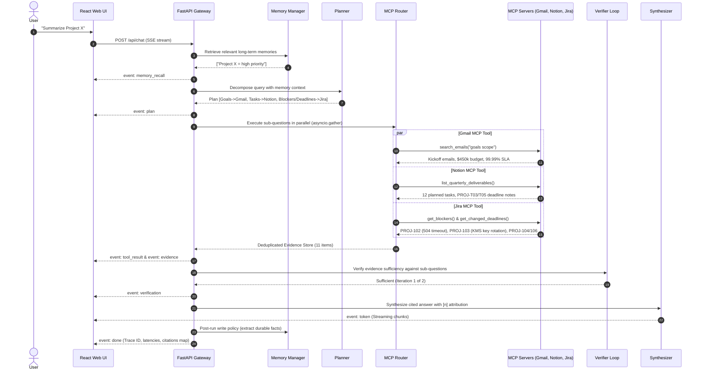

# Architecture Specification: Agentic RAG over Live Data and Memory

## 1. System Overview

Classic Retrieval-Augmented Generation (RAG) relies on a static, pre-indexed vector store created from static documents. In modern enterprise environments, knowledge lives across disparate, continuously changing platforms:
- **Gmail**: Executive decisions, steering committee notes, kickoff scopes, and budget approvals.
- **Notion**: Product requirement documents, roadmap milestones, and quarterly deliverables.
- **Jira**: Real-time sprint issues, active impediments/blockers, and rescheduled deadlines.

This system upgrades static document retrieval into an **Autonomous Agentic RAG System** using the **Model Context Protocol (MCP)**, parallel query decomposition, self-correction verification loops, and a short/long-term memory subsystem.

---

## 2. Mermaid Architecture Diagram

```mermaid
flowchart TD
    User([User / Browser Client]) -->|HTTP SSE /api/chat| API[FastAPI Gateway & Agent Core]
    
    subgraph Agent Core Pipeline
        MemMgr[Memory Manager]
        STM[(Short-Term Memory Buffer)]
        LTM[(Long-Term Memory: SQLite)]
        MemMgr <--> STM
        MemMgr <--> LTM
        
        Planner[Planner / Query Decomposer]
        Router[Parallel MCP Router & Tool Executor]
        Verifier[Self-Correction Verifier Loop]
        Synthesizer[Synthesizer with Strict Citations]
        Tracer[Observability Tracer]
        
        MemMgr -->|Recalled Memories & Priorities| Planner
        Planner -->|Independent Sub-Questions| Router
        Router -->|Collected Evidence| Verifier
        Verifier -->|Insufficient? Max 2 Iterations| Router
        Verifier -->|Sufficient Evidence| Synthesizer
        Synthesizer -->|Post-Run Memory Extraction| MemMgr
    end

    subgraph MCP Tool Ecosystem [stdio / JSON-RPC]
        Router <-->|MCP Protocol| MCP_Gmail[Gmail MCP Server]
        Router <-->|MCP Protocol| MCP_Notion[Notion MCP Server]
        Router <-->|MCP Protocol| MCP_Jira[Jira MCP Server]
    end

    subgraph Dual-Mode Data Layer [DATA_MODE=demo | live]
        MCP_Gmail --> GmailDemo[(Seeded Kickoff & RFCs)]
        MCP_Gmail -.-> GmailLive[(Live Gmail API OAuth2)]
        
        MCP_Notion --> NotionDemo[(Seeded 12 Deliverables & PRDs)]
        MCP_Notion -.-> NotionLive[(Live Notion REST API)]
        
        MCP_Jira --> JiraDemo[(Seeded Blockers & Changed Due Dates)]
        MCP_Jira -.-> JiraLive[(Live Jira Cloud REST API)]
    end

    Synthesizer -->|Cited Markdown + [n] Evidence| Streamer[SSE Event Stream]
    Tracer -->|Live Traces & Latencies| Streamer
    Streamer --> User
```

---

## 3. End-to-End Execution Sequence Flow



---

## 4. Key Security & Prompt Injection Protections

1. **Untrusted Data Sanitization**: All content retrieved from live Gmail messages, Notion pages, and Jira issues is processed through `mcp-servers/shared/sanitizer.py`.
2. **Directive Stripping**: Regular expressions neutralize jailbreak patterns (e.g., `ignore previous instructions`, `system override: true`, `<system>` tags).
3. **Structured Pydantic Enforcement**: LLM output for planner, verifier, and memory extraction is constrained to strict JSON schemas, preventing raw prompt hijacking from poisoning control flow.
4. **Read-Only API Scopes**: Live mode integrations enforce strictly read-only OAuth scopes (`gmail.readonly`, Notion read query, Jira read issue).
